<!-- GitHub Sponsors profile — preview. Art is generated by gen.py (light + dark). -->

<picture>
  <source media="(prefers-color-scheme: dark)" srcset="banner-dark.svg">
  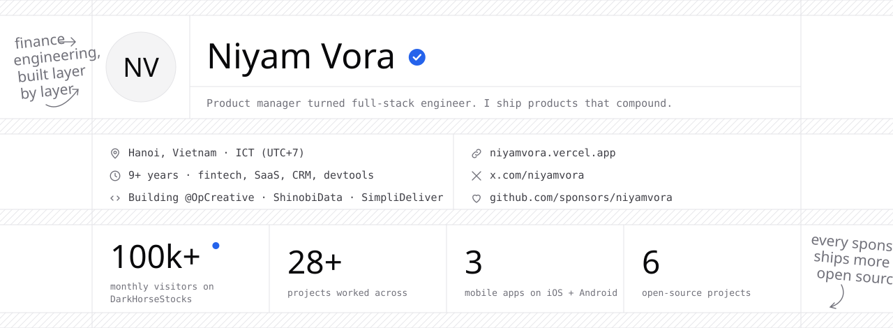
</picture>

<p align="center">
  <a href="https://niyamvora.vercel.app">Portfolio</a> ·
  <a href="https://x.com/niyamvora">X</a> ·
  <a href="https://www.linkedin.com/in/niyam-vora-1b7411333/">LinkedIn</a> ·
  <a href="https://github.com/niyamvora">GitHub</a> ·
  <a href="https://www.npmjs.com/package/fontfetch">npm</a> ·
  Resume (<a href="../resume/Niyam-Vora-Resume-light.pdf">light</a> / <a href="../resume/Niyam-Vora-Resume-dark.pdf">dark</a>) ·
  <a href="mailto:niyamvora@gmail.com">Email</a>
</p>

### Hi, I'm Niyam 👋

I started as a product manager and grew into a full-stack engineer. I joined the team building **[DarkHorseStocks](https://www.darkhorsestocks.in/)** when it had no users and grew it to **100k+ registered users** and **100k+ monthly visitors**, learning to build the whole product myself along the way, from schema to storefront. Today, after 9+ years across fintech, SaaS and CRM, I ship production platforms end to end: TypeScript, Postgres, AWS and MCP servers for AI agents.

Now I open-source the tools I build for my own work: a native **macOS notch app**, a **webfont extractor**, a **component picker that AI agents can drive**, and a **free MCP server for equity research**. Your sponsorship keeps them **free, maintained, and shipping**.

## Open for work

<picture>
  <source media="(prefers-color-scheme: dark)" srcset="hire-dark.svg">
  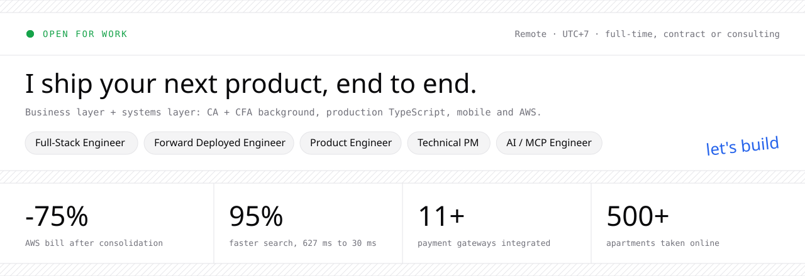
</picture>

I'm open to **full-time, contract and consulting** work as a **full-stack engineer**, **forward deployed engineer**, **product engineer** or **technical PM**. I work remotely from Vietnam (UTC+7) and have shipped with teams in India, Singapore and the US.

| I can help you… | Where I've done it |
| --- | --- |
| **Go from idea to production.** Schema, API, UI, infra and launch, all owned end to end | [OpCreative](https://opcreative.us/): ~86k-line platform in production, cut over from the legacy system with zero downtime |
| **Embed with your customers.** Forward-deployed: sit with the people using it and ship the integration they need | [SimpliDeliver](http://www.simplideliver.com/): 5 messaging channels and in-chat payments through Meta |
| **Put AI on your data.** MCP servers, agents, tool calling, natural-language search | [ShinobiData MCP](https://shinobidata.com/mcp) (32 OAuth tools) and [Fundalysis MCP](https://fundalysis.darkhorsestocks.in/mcp) (17 tools), used from Claude and ChatGPT |
| **Take payments anywhere.** India, Southeast Asia and global gateways | 11+ gateways: Stripe, PayPal, Razorpay, PayU, Cashfree, BillDesk, MoMo, ZaloPay… |
| **Cut your cloud bill.** Consolidation and right-sizing on AWS | 3 AWS accounts into 1 ECS host: **-75%** monthly bill, ~5 s total downtime |
| **Build fintech data products.** Screeners, ETL, real-time market data | [ShinobiData](https://www.shinobidata.com/en): 10k+ tickers, sub-50 ms filters · [Fundalysis](https://fundalysis.darkhorsestocks.in): 4.9M+ mutual fund holdings since 2012 |
| **Send email that lands.** Multi-tenant Amazon SES and self-hosted SMTP | [SimpliDeliver Email](https://simplideliver.com/email/) on SES with BYODKIM, plus a self-hosted Postfix server scoring 10/10 on mail-tester |
| **Take an offline business online.** Booking, channel sync and cashless payments | Maisonnha: 500+ serviced apartments in Hanoi, **+50%** occupancy |

<p align="center">
  <b>Let's talk →</b>
  <a href="mailto:niyamvora@gmail.com?subject=Let%27s%20work%20together">Email me</a> ·
  <a href="https://www.linkedin.com/in/niyam-vora-1b7411333/">LinkedIn</a> ·
  <a href="https://x.com/niyamvora">DM on X</a> ·
  <a href="../resume/Niyam-Vora-Resume-light.pdf">Resume</a>
</p>

<picture>
  <source media="(prefers-color-scheme: dark)" srcset="divider-dark.svg">
  
</picture>

## What you're funding

<table>
  <tr>
    <td width="50%"><a href="https://github.com/niyamvora/ILoveNotch"><picture><source media="(prefers-color-scheme: dark)" srcset="card-ilovenotch-dark.svg">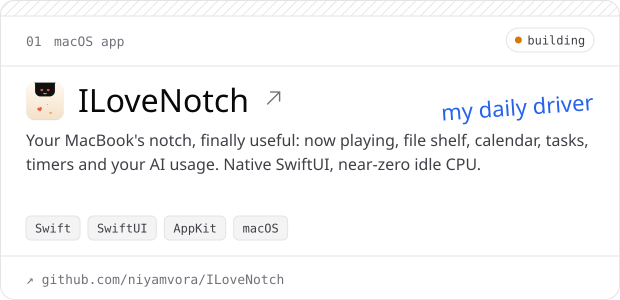</picture></a></td>
    <td width="50%"><a href="https://github.com/niyamvora/fontfetch"><picture><source media="(prefers-color-scheme: dark)" srcset="card-fontfetch-dark.svg">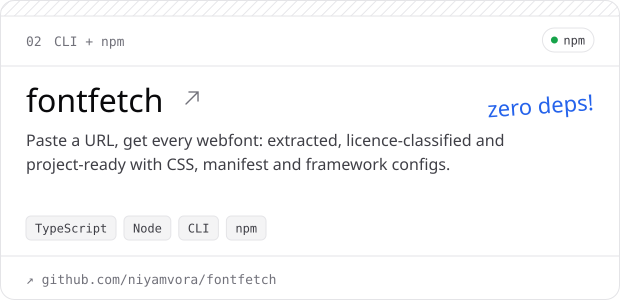</picture></a></td>
  </tr>
  <tr>
    <td width="50%"><a href="https://github.com/niyamvora/component-picker"><picture><source media="(prefers-color-scheme: dark)" srcset="card-component-picker-dark.svg">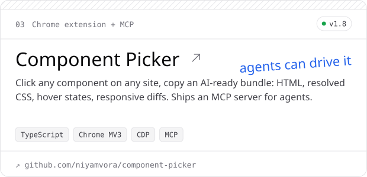</picture></a></td>
    <td width="50%"><a href="https://shinobidata.com/mcp"><picture><source media="(prefers-color-scheme: dark)" srcset="card-shinobidata-mcp-dark.svg">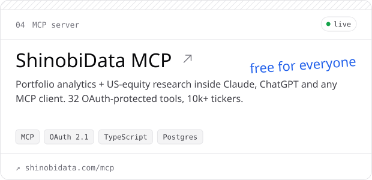</picture></a></td>
  </tr>
  <tr>
    <td width="50%"><a href="https://niyamvora.github.io/chimes/"><picture><source media="(prefers-color-scheme: dark)" srcset="card-chimes-dark.svg">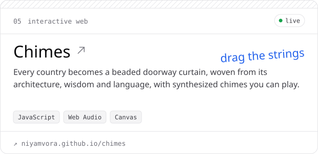</picture></a></td>
    <td width="50%"><a href="https://github.com/niyamvora/niyam-notionaly"><picture><source media="(prefers-color-scheme: dark)" srcset="card-notionaly-dark.svg">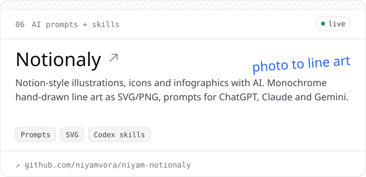</picture></a></td>
  </tr>
</table>

**Quick installs**

```bash
npx fontfetch https://stripe.com                             # every webfont, project-ready
claude mcp add component-picker -- npx component-picker-mcp  # let your agent pick components
```

ShinobiData MCP: in Claude or ChatGPT, go to **Settings → Connectors → Add custom** and paste `https://mcp.shinobidata.com/api/mcp/mcp`. It's free, and you sign in with OAuth.

**Also contributing to [OpenMLS](https://github.com/openmls/openmls)**, the Rust implementation of the Messaging Layer Security (MLS) end-to-end encryption protocol: merged [#2172](https://github.com/openmls/openmls/pull/2172) (credential signing through the crypto provider) and [#2170](https://github.com/openmls/openmls/pull/2170) (ML-DSA post-quantum signatures).

## Products I've worked on

<picture>
  <source media="(prefers-color-scheme: dark)" srcset="products-dark.svg">
  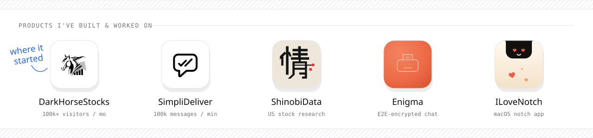
</picture>

| | Product | What it is |
| :---: | --- | --- |
|  | **[DarkHorseStocks](https://www.darkhorsestocks.in/)** | Stock research platform I helped build from zero users to **100k+ registered users** and **100k+ monthly visitors**, with [iOS](https://apps.apple.com/us/app/darkhorsestocks/id6756486172) and [Android](https://play.google.com/store/apps/details?id=com.darkhorsestocks.app) apps and ~19k followers on [Instagram](https://www.instagram.com/darkhorse_stocks). Scroll to the bottom of the site for the custom-designed footer. |
| <picture><source media="(prefers-color-scheme: dark)" srcset="logos/simplideliver-dark.png"></picture> | **[SimpliDeliver](http://www.simplideliver.com/)** | Marketing CRM that sends **up to 100k messages a minute** across WhatsApp, Instagram, Messenger and Zalo |
|  | **[ShinobiData](https://www.shinobidata.com/en)** | US stock research platform, similar to Screener and Tijori: 10k+ tickers, 200+ screening filters and natural-language search |
| | **[Fundalysis](https://fundalysis.darkhorsestocks.in)** | Indian mutual fund analytics: 4.9M+ holdings from 37 fund houses since 2012, with a 17-tool [MCP server](https://fundalysis.darkhorsestocks.in/mcp) |
| | **[OpCreative](https://opcreative.us/)** | Warehouse management and print-on-demand fulfillment for a Vietnamese client: ~86k-line platform in 7 languages, with an [MCP server](https://opcreative.us/mcp) |
| | **Maisonnha** | Took a 500+ unit serviced-apartment business in Hanoi online: direct booking, a channel manager across Airbnb, Booking.com and Agoda, and cashless payments |
| <picture><source media="(prefers-color-scheme: dark)" srcset="logos/simplideliver-dark.png"></picture> | **[SimpliDeliver Email](https://simplideliver.com/email/)** | Transactional email on AWS SES, with a REST API, event pipeline, BYODKIM and an [npm SDK](https://www.npmjs.com/package/simplideliver-email) |
|  | **Enigma** | Privacy-first messenger with an MLS end-to-end encryption tier and one Rust crypto core for iOS and Android |

<picture>
  <source media="(prefers-color-scheme: dark)" srcset="divider-dark.svg">
  
</picture>

<picture>
  <source media="(prefers-color-scheme: dark)" srcset="journey-dark.svg">
  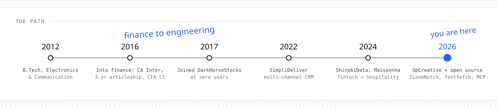
</picture>

## Tiers

| | Backer | Spark Supporter | Silver | Gold | Platinum |
| --- | :---: | :---: | :---: | :---: | :---: |
| **Price** | $10 once | $20 once | $20 / mo | $50 / mo | $200 / mo |
| Thank-you shoutout on [X](https://x.com/niyamvora) | ✓ | ✓ | monthly | monthly | monthly |
| Name / logo on the sponsor wall |  | ✓ | ✓ | ✓ | ✓ |
| Logo in every project README + backlink |  |  | ✓ | ✓ | ✓ |
| Highlighted placement |  |  |  | ✓ | top spot |
| Priority on your issues & feature requests |  |  |  | ✓ | ✓ |
| Monthly 30-min call: product, AI, MCP |  |  |  |  | ✓ |
| Private support by email |  |  |  |  | ✓ |

Companies can sponsor too. GitHub issues invoices, and one-time sponsorships are always welcome.

## Sponsors

<picture>
  <source media="(prefers-color-scheme: dark)" srcset="wall-dark.svg">
  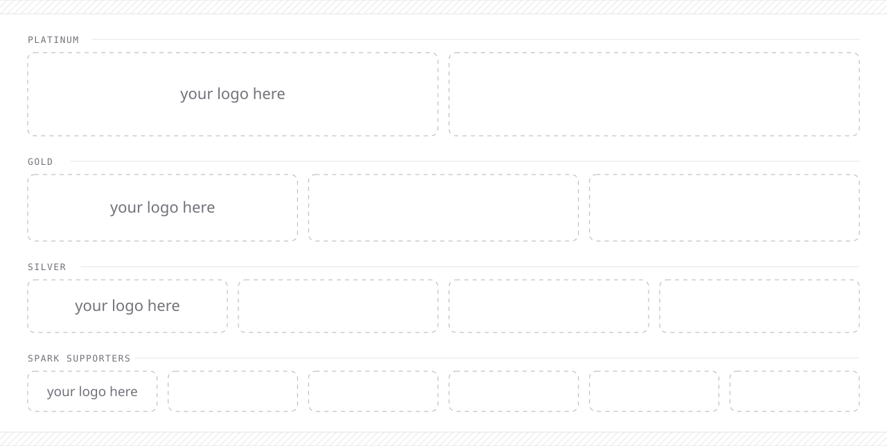
</picture>

<p align="center"><b>Every sponsorship, big or small, goes straight into shipping more open source. Thank you. 🙏</b></p>
